# 🥷 NinjaPace – iPhone App

> **The training hub.**  
> Daily goals, workout history, achievements, warrior themes, Watch synchronization, and live streaming telemetry.

[Ecosystem overview](../README.md) · [Streaming HUD](../docs/README-Streaming-HUD.md) · [Screenshot checklist](../docs/SCREENSHOTS.md)

---

## 1. Overview

The NinjaPace iPhone app is the central control and training experience in the NinjaPace ecosystem.

The Apple Watch owns the active workout. The iPhone receives authoritative workout telemetry, provides the full training UI, stores completed workouts, synchronizes goals and themes, and optionally forwards live telemetry to the NinjaPace Mac companion for OBS streaming.

```text
Apple Watch
    │
    │ HealthKit workout telemetry
    │ WatchConnectivity / workout mirroring
    ▼
iPhone
HealthStreamManager
    │
    ├── SwiftData workout history
    ├── Training schedule / daily goals
    ├── Achievements / themes / HUD configuration
    └── StatsPushClient
            │
            │ HTTP POST /ingest
            ▼
        NinjaPace Mac
            │
            ▼
        OBS Browser HUD
```

NinjaPace follows a simple rule:

> **Fitness first. Streaming second.**

The fitness experience remains useful even when the Mac relay and streaming features are never enabled.

[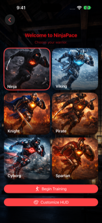](../docs/images/iphone/welcome-warrior-selection.png) [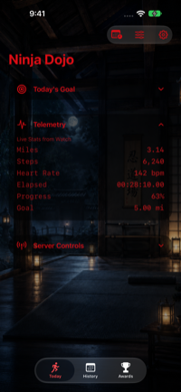](../docs/images/iphone/today-live.png) [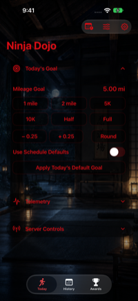](../docs/images/iphone/today-goal.png)

---

## 2. Core Responsibilities

### 🏃 Training Dashboard

The Today screen provides:

- Current workout status
- Apple Watch connection state
- Daily mileage goal
- Goal progress
- Live telemetry
- Mac relay state
- Workout controls
- Quick access to training schedule, HUD customization, and relay settings

### 🎯 Daily Goals and Training Schedule

NinjaPace includes:

- A weekly mileage schedule
- Running days
- Custom-mileage days
- Rest days
- Schedule-provided daily defaults
- Manual same-day goal overrides
- Race-distance locks for:
  - 5K
  - 10K
  - Half Marathon
  - Marathon

A manual goal override affects the current day without permanently replacing the weekly schedule.

A `0.00 mi` goal is valid and represents a legitimate rest-day target.

### 📚 Workout History

Completed workouts are stored with SwiftData.

Workout history can preserve:

- Start and end time
- Distance
- Goal distance
- Goal completion
- Total duration
- Active duration
- Paused duration
- Steps
- Average cadence
- Pace
- Average speed
- Peak speed
- Average heart rate
- Peak heart rate
- Active calories
- Total calories
- Elevation gain when available
- Workout location classification
- Splits
- Heart-rate zones
- Achievements unlocked during the workout

History is grouped by month with expandable sections.

### Workout Trends

Open **History → Workout Trends** for the Swift Charts dashboard in `WorkoutTrendsView.swift`. History includes a compact preview of the six most recent monthly mileage totals and a comparison with the preceding month.

- **Monthly or Yearly:** browse the available history with horizontal chart scrolling and select a period to update its summary and Training Intel.
- **Ten metrics:** Miles, Workouts, Duration, Steps, Avg Distance, Avg Pace, Avg Heart Rate, Calories, Cadence, and Goal Rate.
- **Training Intel and best period:** highlight period-to-period changes and the best recorded period for the selected metric. Pace ranks lower values as faster; the heart-rate highlight identifies the highest recorded average, not a fitness assessment.
- **Battle Record:** lifetime mileage, workout count, and completed goals from the locally available workout history.

`WorkoutTrendEngine` groups records by workout start date in the current calendar and includes empty periods through the current month or year. Duration uses active workout time. Average pace divides eligible active duration by eligible distance; heart rate and cadence use active-duration-weighted averages. Calories sums recorded active calories, and Goal Rate divides completed goals by workouts with a known positive target. Missing optional measurements remain unavailable rather than becoming zero readings.

Recovered workouts contribute the fields they retain. Restoring an original mileage goal can update Goal Rate and completed-goal totals. The view’s “Workout Trends” SwiftUI preview uses an in-memory store with nine months of sample workouts.

### 🏆 Awards and Progression

NinjaPace includes an achievement system for workout milestones and progression. Tap any badge in Awards to open `AchievementDetailView`: unlocked badges show their first-earned date and either qualifying workout counts or current cumulative progress; locked badges show a progress bar and percentage. The next locked milestone in the same progression appears as a Next Target card when available.

First-earned dates prefer stored unlock events and otherwise are reconstructed from the available workout history. Qualifying counts apply to repeatable distance and goal-performance achievements; cumulative milestones show current progress instead.

Completed workouts retain the achievement IDs earned during that run so historical records preserve the state of the workout when it happened.

### 🥷 Warrior Themes

Six warrior identities are supported:

- 🥷 Ninja
- 🪓 Viking
- 🛡️ Knight
- 🏴‍☠️ Pirate
- 🤖 Cyborg
- 🏛️ Spartan

Themes can affect:

- App tint
- Background artwork
- Toolbar iconography
- Text treatment
- HUD title and subtitle
- HUD colors
- Glow treatment
- Streaming presentation

The selected warrior is synchronized through the NinjaPace ecosystem.

---

## 3. Main App Structure

The primary iPhone experience is organized into three tabs.

### Today

The active training dashboard.

### History

Saved workouts and detailed historical metrics.

### Awards

Achievements, milestones, and progression. Tap a badge to inspect its earned history, progress, and next target.

[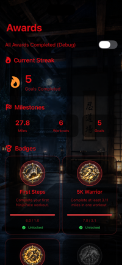](../docs/images/iphone/awards.png) [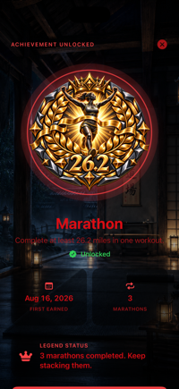](../docs/images/iphone/achievement-unlocked.png) [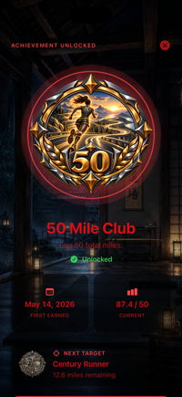](../docs/images/iphone/achievement-next-target.png)

*SwiftUI preview captures with sample data. The All Awards Completed switch is Debug-only; achievement details are available in production.*

#### NinjaPace Grandmaster

Unlock every lifetime achievement in the current collection to become **NinjaPace Grandmaster**. Awards presents a full-screen **Collection Mastered** celebration with the Grandmaster badge, the completed award count, and **100% COMPLETE**. Select **Enter the Hall of Legends** to return to Awards, where your Grandmaster recognition remains visible. Monthly challenge badges are tracked separately from this lifetime collection.

`AchievementMasteryView` uses the dedicated `.grandmaster` celebration style: three staggered particle bursts and a Grandmaster title, alongside a glowing badge and animated ring. Its dedicated Grandmaster sound plays when Goal Celebrations is enabled.

[](../docs/images/iphone/achievement-grandmaster.png)

*SwiftUI preview showing the current 24-award collection. This still captures the mastery screen after the opening particle bursts; it does not demonstrate animation or sound playback.*

#### Monthly Challenge Badges

Open **Awards → Monthly Challenges** to explore a collection of 12 monthly missions. Challenges vary between workout counts, total mileage, and a single-workout distance target—for example, November’s **Iron Will** asks you to complete 12 workouts during the month.

Locked badges appear in grayscale with a shield-lock overlay. Earned badges reveal their full-color artwork. Open a month to see its mission, progress, and availability; earned rewards are recorded by month and year in the **Monthly Hall of Legends**.

**Monthly Challenges screen**

[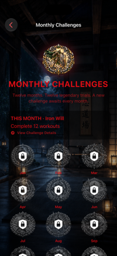](../docs/images/iphone/monthly-challenges-screen.png)

*Captured from the Monthly Challenges SwiftUI preview with an empty in-memory workout store. The current mission follows the calendar month.*

**Unlocked monthly challenge**

[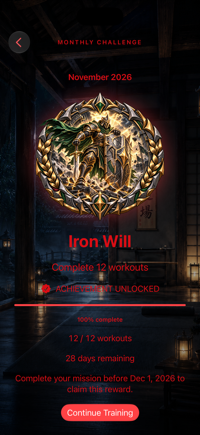](../docs/images/iphone/monthly-challenge-unlocked.png)

*The “Monthly Challenge - Unlocked” SwiftUI preview shows November’s Iron Will badge at 100% completion. Its Debug override does not save a reward, so the preview still displays the remaining-time message.*

**Locked collection · Unlocked collection**

[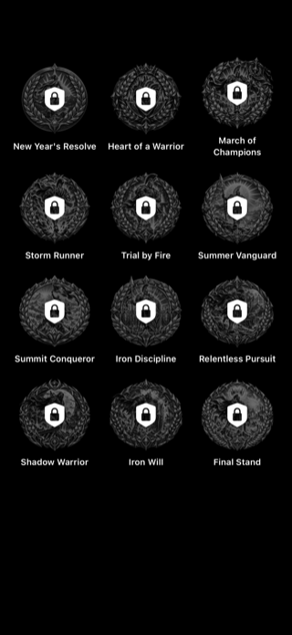](../docs/images/iphone/monthly-badges-locked.png) [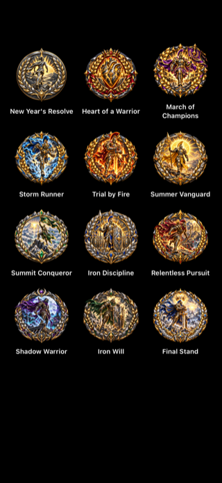](../docs/images/iphone/monthly-badges-unlocked.png)

*SwiftUI badge-gallery previews from `MonthlyChallengeBadgeView.swift`, illustrating both visual states. The unlocked collection is a preview, not a record of earned rewards.*

### Training and History Screenshots

[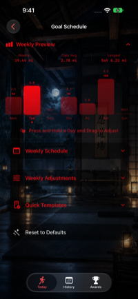](../docs/images/iphone/training-schedule.png) [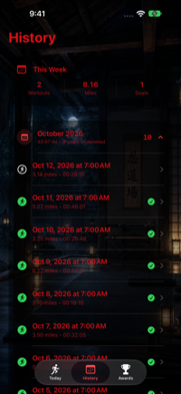](../docs/images/iphone/history.png) [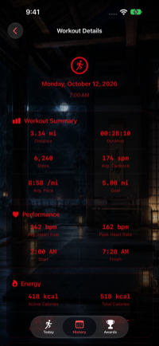](../docs/images/iphone/workout-detail.png)

---

## 4. HealthStreamManager

`HealthStreamManager` is the central iPhone runtime manager.

Responsibilities include:

- HealthKit authorization
- Apple Watch connectivity
- Mirrored workout handling
- Live telemetry state
- Workout lifecycle state
- Smooth elapsed-time rendering
- Daily goal state
- Training schedule integration
- Theme synchronization
- Watch settings synchronization
- Workout history persistence
- Mac relay telemetry
- HUD configuration persistence

Representative runtime state includes:

```swift
miles
steps
heartRateBpm

activeCalories
totalCalories
peakSpeedMPH

goalMiles

elapsedSecondsFromWatch
pausedDuration

isWorkoutRunning
isWorkoutPaused

themeKey
hudConfiguration
```

---

## 5. Workout Lifecycle

The Apple Watch is the source of truth for the active workout.

```text
Start Workout
    ↓
Apple Watch HKWorkoutSession
    ↓
Live telemetry
    ↓
iPhone HealthStreamManager
    ↓
Optional Mac relay
    ↓
OBS HUD
```

Supported workout commands:

- Start
- Pause
- Resume
- Stop

Pause intervals are accumulated separately from active workout time.

```text
Total Duration     01:45:30
Paused Time        00:06:20
Active Duration    01:39:10
```

Pace and speed calculations are based on active workout time rather than paused wall-clock time.

---

## 6. Live Telemetry

A live payload can include:

```swift
struct Payload {
    var theme: String

    var miles: Double
    var steps: Int
    var hr: Int

    var elapsed: String
    var elapsedSeconds: Int
    var elapsedMilliseconds: Int

    var pace: String

    var activeCalories: Double
    var totalCalories: Double

    var goalMiles: Double
    var progress: Double

    var running: Bool
    var paused: Bool

    var hudConfiguration: HUDConfiguration?
}
```

When Mac streaming is enabled, `StatsPushClient` sends the payload to:

```text
POST /ingest
```

on the NinjaPace Mac relay.

---

## 7. Smooth Elapsed Time

NinjaPace does not wait for a fresh network packet every time the stopwatch needs to advance.

The Apple Watch supplies authoritative elapsed-time checkpoints.

The iPhone interpolates locally between Watch updates so elapsed time remains visually smooth.

The Mac companion performs the same type of local interpolation independently.

---

## 8. HUD Customization

The iPhone app includes a dedicated HUD editor.

Users can customize:

- HUD title
- Subtitle
- Live color
- Paused color
- Idle color
- Goal color
- Background color
- Background opacity
- Glow intensity
- HUD scale
- Text scale
- Text weight
- Text outline
- Border settings

Visible metrics can be toggled individually:

- Miles
- Steps
- Heart Rate
- Calories
- Elapsed Time
- Pace
- Goal Progress

Each warrior theme provides its own starting HUD preset.

The editor includes a live preview with selectable states:

- Live
- Paused
- Idle
- Goal

[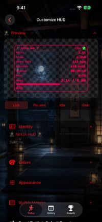](../docs/images/iphone/hud-customization.png)

---

## 9. Mac Relay Setup

`StatsPushClient` handles communication from iPhone to Mac.

Responsibilities:

- Persist relay address
- Normalize relay URL input
- Build telemetry payloads
- POST telemetry to the relay
- Test relay connectivity
- Report connection state
- Recover gracefully from temporary network failures

The relay address is treated as sensitive UI and remains hidden until the user explicitly unlocks it.

Ordinary transient relay failures are handled through inline state instead of disruptive modal alerts.

[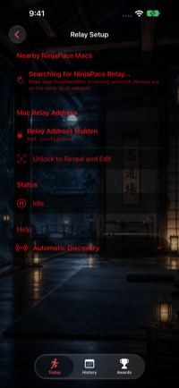](../docs/images/iphone/relay-setup-locked.png)

---

## 10. Background Streaming Behavior

The Watch owns the active HealthKit workout. It sends each telemetry snapshot over both WatchConnectivity live messaging and HealthKit mirroring, and stores a latest-state application-context checkpoint.

HealthKit mirroring alone may buffer snapshots for minutes while iOS is suspended.
WatchConnectivity live messages can wake the reachable companion iPhone app to process fresh metrics. The phone rejects duplicate/older timestamped snapshots, then forwards accepted updates to the Mac using a finite background execution allowance and a five-second request timeout.

This does not grant unlimited iOS execution or guarantee delivery when devices are unreachable, the app is force-quit, or network access is unavailable. Mac elapsed time can continue interpolating during a gap; Miles, Steps, and Heart Rate require fresh Watch samples. The Watch continues recording independently.

### Physical-device validation

Simulator UI fixtures do not validate real background delivery. Install both app builds on a paired Watch and iPhone, start the Mac relay, and enable streaming.
Start a Watch workout, confirm live metrics, then put the phone on its Home Screen and lock it for at least five minutes. 
Compare Mac/OBS Miles, Steps, and Heart Rate against the Watch while exercising; an advancing timer alone is not sufficient.
Repeat pause/resume and stop with the phone locked, then reopen the phone and verify there is no large metric catch-up. Also check recovery after temporarily leaving connection range. Run without the debugger attached, which can change suspension.

Apple references:
- [Mirrored workout data delivery](<https://developer.apple.com/documentation/healthkit/hkworkoutsessiondelegate/workoutsession(_:didreceivedatafromremoteworkoutsession:)>)
- [WatchConnectivity messaging](https://developer.apple.com/documentation/watchconnectivity/transferring-data-with-watch-connectivity)

---

## 11. Persistence and Recovery

NinjaPace maintains latest-state checkpoints between Watch and iPhone.

This helps recover when:

- The iPhone app relaunches
- Watch connectivity temporarily changes
- The devices briefly disconnect
- The iPhone reconnects to an already-running workout

The app protects against stale telemetry replacing newer workout state and requests a fresh Watch snapshot when appropriate.

---

## 12. Error Handling

User-facing alerts are reserved for failures that need attention, such as:

- HealthKit setup failures
- Workout start failures
- Workout stop/save failures
- Relay startup failures
- Missing streaming HUD resources

Expected transient network and telemetry recovery events are handled silently or with inline status.

---

## 13. Automated UI Testing

The iPhone app has a deterministic DEBUG UI-test harness.

Launch environment:

```text
NINJAPACE_IPHONE_UI_TEST_STATE
```

Supported states:

```text
welcome
ready
live
```

The UI-test harness:

- Uses an in-memory SwiftData container
- Avoids real HealthKit authorization
- Avoids real WatchConnectivity dependencies
- Avoids real Bonjour discovery
- Avoids starting the real local HTTP server
- Provides deterministic telemetry fixtures

Current UI coverage includes:

- Welcome and warrior selection
- Main-tab navigation
- Goal presets
- Rest-day zero-goal protection
- Goal fine tuning and rounding
- Training schedule navigation
- Accordion behavior
- HUD navigation
- HUD preview states
- HUD metric visibility persistence
- HUD reset behavior
- HUD title persistence
- Warrior → HUD preset integration
- Relay privacy state
- Live telemetry
- Launch performance

---

## 14. Technology

Primary technologies:

- Swift
- SwiftUI
- SwiftData
- HealthKit
- WatchConnectivity
- CoreMotion
- Network framework
- async/await
- XCTest / XCUITest

---

## 15. Design Principles

### Fitness First
Streaming enhances the workout but is never required.

### Watch as Workout Authority
The Apple Watch owns the active workout and authoritative telemetry.

### Graceful Recovery
Temporary connectivity problems should not destroy workout state.

### Direct Manipulation
Goals and schedules favor intuitive interaction over configuration-heavy UI.

### Style Matters
Running software can still have ninjas, Vikings, knights, pirates, cyborgs, and Spartans.

---

## 16. Potential Future Enhancements

- Additional workout types
- Metric / imperial unit selection
- More achievement categories
- Advanced historical analytics
- Training streak visualization
- More warrior themes
- Multiple saved training schedules
- Expanded heart-rate-zone visualization
- Additional streaming integrations

---

# 🥷 NinjaPace

**Run the miles.  
Choose your warrior.  
Own the workout.**

## Recover History After Reinstalling

**History → Recover History** finds running workouts recorded by NinjaPace that remain in Apple Health. Grant read access, review the results, and recover them without changing Health records or duplicating existing history. This feature and historical goal editing are included in Release builds.

[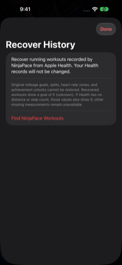](../docs/images/iphone/history-recovery.png)

To restore goal completion, open a workout and select **Goal Performance → Set Original Goal**. Saving the original target updates completed goals, Awards, and warrior progression. Recovery is not a full backup of app settings, goals, splits, or historical achievement unlocks. See [recovery details](../docs/HISTORY-RECOVERY.md).

## Built for iPhone Duo

On the Duo’s compact display, Today’s Goal, Telemetry, and Server Controls become a horizontal row of icons. Tap one to expand its controls; collapse it to return to warrior progress without overlap.

The welcome screen scrolls to keep every warrior and action reachable. Folded layouts use two columns; expanded layouts use three, with square cards that preserve the artwork’s proportions.

**Compact training and folded welcome (scrolled to the actions)**

[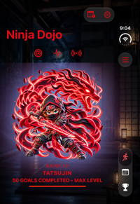](../docs/images/iphone/duo-training-compact.png) [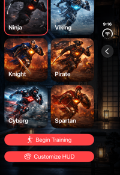](../docs/images/iphone/duo-welcome-folded.png)

**Expanded welcome**

[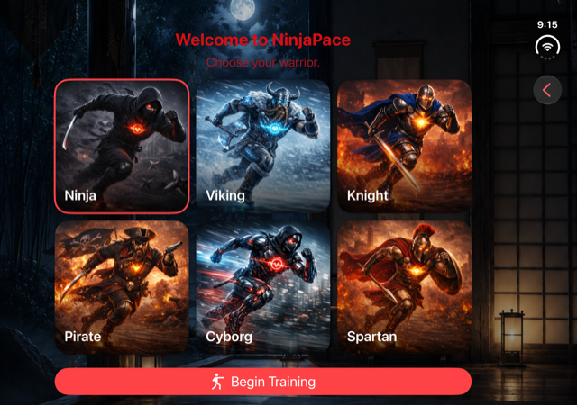](../docs/images/iphone/duo-welcome-expanded.png)

*Simulator captures. Training shows demo data with the maximum-rank artwork preview.*

## Stay on Track and Celebrate Your Goals

Open **Settings → Goal Alerts** to enable a daily local reminder and choose its time (6 PM by default). NinjaPace schedules reminders ahead of time, skips rest days, and cancels the day’s pending reminder when it observes your goal completion. Notifications require iOS permission; no remote notification server is needed.

With **Settings → Goal Celebrations** enabled, reaching your target during an active workout while NinjaPace is in the foreground triggers a brief warrior-themed animation, sound, and success feedback. The effect adapts to Reduce Motion. Raising your target above your current progress allows a new celebration when you reach it.

[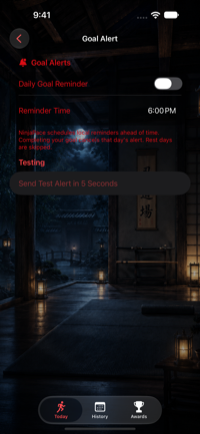](../docs/images/iphone/goal-alerts.png) [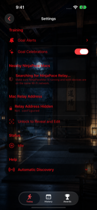](../docs/images/iphone/goal-celebration-settings.png) [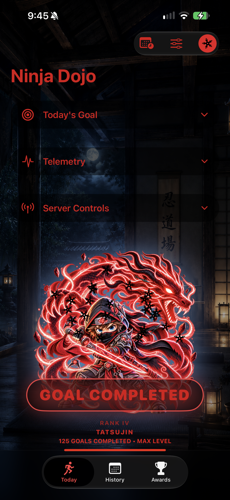](../docs/images/iphone/goal-celebration.png)

*Simulator captures. The Testing section is Debug-only; the celebration still uses the Debug preview gesture and includes the simulator window. A still image does not demonstrate sound or notification delivery.*

### Reminder and celebration behavior

- Daily reminders are off by default. Enabling them requests alert and sound authorization. If access is denied, Goal Alerts links to iOS Settings.
- The reminder window covers the next 14 days. Today uses the resolved goal, including manual overrides; future days use schedule defaults when enabled, otherwise the current goal. Opening the app and changing relevant settings refresh the schedule.
- Completing a goal cancels that day’s pending reminder and keeps that day quiet on subsequent refreshes. This depends on NinjaPace receiving the completion; background telemetry delays can affect cancellation.
- Celebrations are on by default and can be disabled independently of daily reminders. A goal crossing is consumed while backgrounded or disabled, so it is not replayed later. Ending the workout resets the celebration state.
- A celebration also requests an immediate themed local goal-achieved notification when notification authorization allows it. This path is tied to presenting the foreground celebration; it is not an independent background goal detector. Banner presentation follows iOS notification behavior.
- The short bundled theme sound uses an ambient audio session. UI-test launches intentionally suppress audio. Production reminders and celebrations are not Debug-only; the five-second test alert and double-tap warrior preview gesture are Debug-only.
