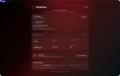
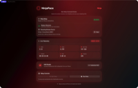
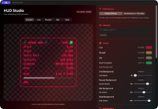
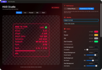

# 🥷 NinjaPace – Mac Companion

> **The streaming bridge.**  
> A local telemetry relay and customizable browser HUD for OBS and other streaming software.

[Ecosystem overview](../README.md) · [Streaming HUD](../docs/README-Streaming-HUD.md) · [Screenshot checklist](../docs/SCREENSHOTS.md)

---

## 1. Overview

The NinjaPace Mac app is the optional streaming companion for the NinjaPace ecosystem.

It receives live workout telemetry from the iPhone, maintains the latest workout state, serves a browser-based HUD, and exposes live JSON for streaming integrations.

```text
Apple Watch
    ↓
iPhone
StatsPushClient
    │
    │ HTTP POST /ingest
    ▼
NinjaPace Mac
MacRelayServer
    │
    ├── GET /stats
    └── GET /
            │
            ▼
        Browser HUD
            │
            ▼
           OBS
```

There is no cloud relay in the normal path.

Streaming data remains local to the user's network.

---

## 2. Core Responsibilities

### 📥 Receive Telemetry

The Mac accepts live telemetry from the iPhone and keeps the newest workout snapshot in memory.

### 📤 Serve Telemetry

The relay exposes the current state through HTTP for the browser HUD and compatible local tools.

### 🖥️ Host the Browser HUD

The Mac serves the NinjaPace HUD directly for OBS Browser Sources.

### ⏱️ Smooth Elapsed Time

The Mac locally interpolates elapsed time between iPhone telemetry packets so the stopwatch remains visually smooth.

### 🎨 HUD Configuration

The Mac can:

- Follow the HUD configuration from iPhone
- Use a local Mac override
- Preview live HUD changes
- Persist local customization

[](../docs/images/mac/mac-relay-offline.png) [](../docs/images/mac/mac-relay-live.png)

---

## 3. MacRelayServer

`MacRelayServer` is the central Mac runtime component.

Responsibilities include:

- Start and stop the local listener
- Search for an available relay port
- Accept telemetry payloads
- Decode and store the latest stats
- Track the latest receive time
- Serve `/stats`
- Serve the browser HUD
- Preserve the last known theme
- Preserve HUD configuration mode
- Interpolate elapsed time locally
- Surface relay errors to the Mac UI

---

## 4. HTTP Endpoints

Primary endpoints:

```text
POST /ingest
GET  /stats
GET  /
```

### `POST /ingest`

Receives the latest workout state from iPhone.

Example:

```json
{
  "theme": "ninja",
  "running": true,
  "paused": false,
  "miles": 3.14,
  "steps": 6240,
  "hr": 142,
  "elapsed": "00:28:10.00",
  "elapsedSeconds": 1690,
  "elapsedMilliseconds": 1690000,
  "pace": "8:58",
  "activeCalories": 418.0,
  "totalCalories": 518.0,
  "goalMiles": 5.0,
  "progress": 0.63
}
```

### `GET /stats`

Returns the latest stored workout snapshot.

### `GET /`

Returns the NinjaPace browser HUD.

---

## 5. Relay Port Behavior

The preferred relay port is:

```text
8787
```

If that port is unavailable, the Mac companion searches a small fallback range rather than failing immediately.

Current relay range:

```text
8787 ... 8795
```

The active URL is shown in the Mac UI so it can be copied into OBS or used by the iPhone relay configuration.

---

## 6. Telemetry Model

Representative relay state includes:

```swift
struct Stats: Codable, Sendable {
    var theme: String?

    var miles: Double
    var steps: Int
    var hr: Int

    var elapsed: String
    var elapsedSeconds: Int
    var elapsedMilliseconds: Int

    var pace: String

    var activeCalories: Double
    var totalCalories: Double

    var goalMiles: Double
    var progress: Double

    var running: Bool
    var paused: Bool

    var hudConfiguration: HUDConfiguration?
}
```

The relay also tracks when the latest payload was received.

That timestamp is used for smooth local elapsed-time rendering.

---

## 7. Smooth Elapsed-Time Interpolation

The Mac does not need a new HTTP POST every visual frame.

When a workout is:

```text
running == true
paused  == false
```

the Mac can add local wall-clock delta time to the latest authoritative elapsed checkpoint.

When the workout is paused or idle, elapsed time remains fixed at the last authoritative value.

This keeps the browser HUD smooth without increasing network traffic.

---

## 8. HUD States

The browser HUD derives its visual state from telemetry.

| Condition | HUD State |
|---|---|
| `running == false` | Idle |
| `running == true && paused == false` | Live |
| `paused == true` | Paused |
| Goal reached with valid goal | Goal |

A goal of `0.00` is valid for a rest day and must not accidentally trigger Goal state.

---

## 9. Warrior Themes

The Mac companion understands the same six warrior identities as the iPhone app:

- 🥷 Ninja
- 🪓 Viking
- 🛡️ Knight
- 🏴‍☠️ Pirate
- 🤖 Cyborg
- 🏛️ Spartan

The current theme affects:

- Mac UI presentation
- Relay toolbar/icon treatment
- HUD colors
- HUD title
- HUD subtitle
- Browser overlay styling

Theme state can follow the iPhone in real time.

---

## 10. HUD Studio

The Mac includes a dedicated HUD customization experience.

Configuration modes:

```text
Follow iPhone
Customize on This Mac
```

The editor supports:

- Live preview
- Simulated preview states
- HUD title and subtitle
- State colors
- Background colors and opacity
- Border settings
- Glow intensity
- Scale
- Text scale
- Text weight
- Text outline
- Visible metric toggles

Supported metrics include:

- Miles
- Steps
- Heart Rate
- Calories
- Elapsed
- Pace
- Goal

Local Mac overrides are persisted independently from iPhone-following mode.

[](../docs/images/mac/mac-hud-studio-follow-iphone.png) [](../docs/images/mac/mac-hud-studio-local.png)

---

## 11. OBS Integration

Typical OBS Browser Source URL:

```text
http://<mac-lan-ip>:8787/
```

Use the active port shown by NinjaPace Mac if the relay falls back from `8787`.

Typical flow:

```text
Apple Watch
    ↓
iPhone
    ↓
NinjaPace Mac
    ↓
OBS Browser Source
    ↓
Twitch / YouTube / Recording
```

The HUD is designed for:

- Gameplay streams
- Treadmill running
- Fitness challenges
- Marathon streams
- Speedrunning
- Endurance events
- Recorded workout content

---

## 12. Local Network Model

NinjaPace Mac is designed for trusted local-network use.

Normal deployment characteristics:

- Local HTTP
- No cloud account
- No remote backend required
- No database required for live relay state
- Latest telemetry held in memory
- Browser HUD served locally

The iPhone must use the Mac's LAN address rather than `localhost`.

---

## 13. Failure Handling

The Mac UI surfaces failures that require user action.

Examples include:

- Relay could not start
- Relay stopped unexpectedly
- Streaming HUD resource unavailable

Port conflicts are mitigated by automatic fallback across the relay port range.

Ordinary telemetry gaps do not erase the last known workout state.

---

## 14. iPhone Background Limitation

The Apple Watch workout can continue in the background because it owns the HealthKit workout session.

The iPhone, however, may eventually be suspended by iOS when backgrounded.

If the iPhone stops forwarding fresh telemetry:

- The Mac retains the latest workout snapshot
- The Mac can continue elapsed-time interpolation from that checkpoint
- Fresh metric updates resume when the iPhone becomes active again

The Watch sends live WatchConnectivity messages alongside HealthKit mirroring to wake the reachable iPhone for fresh telemetry. The phone gives immediate relay uploads a finite background completion window.

---

## 15. Automated UI Testing

The Mac companion has deterministic XCUITest launch states.

Launch environment:

```text
NINJAPACE_MAC_UI_TEST_STATE
```

Supported states:

```text
offline
waiting
live
```

Current UI coverage includes:

- Offline relay dashboard
- Online relay without active workout
- Live telemetry
- Stop relay → offline transition
- HUD Studio window launch
- Launch performance

Mac XCUITest note:

Some macOS SwiftUI `StaticText` values are exposed through `.value` rather than `.label`.

The UI-test helper reads `.value` first and falls back to `.label`.

---

## 16. Technology

Primary technologies:

- Swift
- SwiftUI
- Network framework
- Combine
- Foundation
- Codable
- Local HTTP
- XCTest / XCUITest
- HTML / CSS / JavaScript for the browser HUD

---

## 17. Design Principles

### Local First
The normal streaming path stays on the LAN.

### Lightweight Relay
The Mac does not own the workout and does not duplicate the iPhone's training logic.

### Smooth Presentation
Elapsed time is interpolated locally for a responsive HUD.

### Optional Streaming
The Mac is not required for the core fitness experience.

### Shared Identity
Theme and HUD presentation remain consistent across Watch, iPhone, and Mac.

---

## 18. Potential Future Enhancements

- Additional stream integrations
- WebSocket push
- More HUD layout presets
- Multiple saved HUD profiles
- Additional local discovery workflows
- Expanded stream status diagnostics
- Multi-output browser layouts

---

# 🥷 NinjaPace Mac

**Receive the telemetry.  
Serve the HUD.  
Own the stream.**
