# 🥷 NinjaPace – Apple Watch App

> **The workout authority.**  
> Real-time HealthKit tracking, goal awareness, haptics, and live telemetry for the NinjaPace ecosystem.

[Ecosystem overview](../README.md) · [Streaming HUD](../docs/README-Streaming-HUD.md) · [Screenshot checklist](../docs/SCREENSHOTS.md)

---

## 1. Overview

The NinjaPace Apple Watch app is the primary workout source.

It owns the active `HKWorkoutSession`, collects HealthKit workout data, manages the live workout state, and sends authoritative telemetry to the iPhone.

```text
HealthKit
    ↓
HKWorkoutSession
    ↓
HKLiveWorkoutBuilder
    ↓
WorkoutManager
    ↓
WatchConnectivity / workout mirroring
    ↓
iPhone HealthStreamManager
```

The Watch remains focused on the job that matters most:

> **Keep the workout alive, accurate, and responsive.**

---

## 2. Core Responsibilities

### 🏃 Workout Execution

Supported workout controls:

- Start
- Pause
- Resume
- Stop

The Watch maintains live state for:

- Running
- Paused
- Ready / idle
- Goal progress

### ❤️ HealthKit Telemetry

The Watch can collect and maintain:

- Distance
- Steps
- Heart rate
- Average heart rate
- Peak heart rate
- Active calories
- Total calories
- Elapsed workout time
- Paused time
- Pace
- Speed
- Peak speed

The active workout is based on a HealthKit running session.

### 📡 iPhone Synchronization

The Watch sends live workout snapshots to the iPhone using WatchConnectivity and mirrored-workout support.

The iPhone then becomes the training, persistence, customization, and optional streaming hub.

### 🎯 Goal Synchronization

The Watch receives the current mileage goal from the iPhone and uses it locally for:

- Goal display
- Progress calculation
- Goal-hit detection
- Workout presentation

### 🥷 Theme Synchronization

The selected warrior theme is synchronized from iPhone so the Watch remains visually aligned with the rest of NinjaPace.

---

## 3. WorkoutManager

`WorkoutManager` is the central Watch runtime component.

Responsibilities include:

- Request HealthKit authorization
- Create and manage `HKWorkoutSession`
- Configure `HKLiveWorkoutBuilder`
- Collect HealthKit statistics
- Maintain workout state
- Track pause/resume behavior
- Track elapsed time
- Maintain goal state
- Trigger milestone haptics
- Send live telemetry to iPhone
- Recover state after temporary connectivity changes

Representative state includes:

```swift
isRunning
isPaused

miles
steps
heartRate

activeCalories
totalCalories

elapsedSeconds
goalMiles
```

Additional derived workout metrics can include pace, speed, peak speed, average heart rate, and peak heart rate.

---

## 4. HealthKit Integration

The Watch owns the active workout session.

Typical data flow:

```text
HKWorkoutSession
    ↓
HKLiveWorkoutBuilder
    ↓
HealthKit statistics
    ↓
WorkoutManager
    ↓
Published UI state + telemetry snapshot
```

Common HealthKit quantities include:

```text
distanceWalkingRunning
heartRate
activeEnergyBurned
stepCount
```

Live updates are driven by the workout builder and session state rather than by polling-heavy application timers.

---

## 5. Telemetry to iPhone

A Watch workout snapshot can include values such as:

```swift
[
    "running": true,
    "paused": false,
    "miles": 3.14,
    "hr": 142,
    "steps": 6240,
    "elapsedSeconds": 1690,
    "activeCalories": 418.0,
    "totalCalories": 518.0,
    "goalMiles": 5.0
]
```

The Watch normally pushes fresh telemetry approximately once per second while the workout is active.

The iPhone treats the Watch as the authoritative source for active workout state.

---

## 6. Background Workout Behavior

One of the most important responsibilities of the Watch app is keeping the workout alive when the display is no longer active.

Because NinjaPace owns an active HealthKit workout session:

- Wrist lowering does not end the workout
- Wrist lock does not end the workout
- The display turning off does not end the workout
- HealthKit continues collecting workout data
- Workout state remains recoverable

The workout session, not the visible SwiftUI screen, is the lifetime anchor for the workout.

---

## 7. Pause and Resume

Pause state is explicit and synchronized.

NinjaPace tracks paused time separately so downstream metrics can use active workout time.

```text
Wall-clock duration
    -
Accumulated paused time
    =
Active workout duration
```

This matters for:

- Pace
- Average speed
- Workout summaries
- Historical records

---

## 8. Goal and Milestone Behavior

The Watch receives `goalMiles` from the iPhone.

Goal progress can be derived as:

```swift
progress = goalMiles > 0
    ? min(miles / goalMiles, 1)
    : 0
```

Important behavior:

- `goalMiles == 0` is a valid rest-day value
- Goal-hit behavior should only trigger when the goal is greater than zero
- Mile milestone haptics provide feedback during the workout
- Goal state can drive a dedicated visual state

---

## 9. Watch UI

Watch v2 uses native vertical pages. Swipe vertically or turn the Digital Crown to browse.

Default pages:

1. **Warrior Home** — full-color warrior artwork, synced rank, state, goal or featured metric, and Start / Pause / Resume.
2. **Overview** — elapsed, pace, heart rate, active calories, steps, and goal progress together.
3. **Distance**
4. **Pace**
5. **Heart Rate** — current, average, and peak.
6. **Elapsed** — active workout time.
7. **Controls** — Start / Pause / Resume and confirmed Stop.

Open the sliders button on Home for **Dashboard** settings. Choose a warrior, enable the idle clock and choose Digital or Analog, hide Overview, choose the featured metric, and enable any of the six focus metrics (including Calories and Steps). These preferences are local to the Watch and persist across launches. Home and Controls always remain available. A rest day displays a rest-day label instead of a meaningless percentage.

Warrior selection uses the manager's existing persisted theme. Incoming iPhone theme settings still apply; local dashboard preferences are not sent to iPhone. All 24 progression illustrations are bundled in the Watch catalog with the same asset names as the iPhone.

Pause and Stop retain their confirmations. Resume is immediate. The manager remains the only workout authority; page navigation never starts, pauses, or stops a session. The root retains goal-crossing haptics and sounds, and Home/progress show a completed-goal treatment. Artwork remains static; the small weapon accent animates only on the visible page while live, with Reduce Motion, inactive scenes, and reduced luminance disabling it.

When **Show Current Time** is enabled, an idle Home displays a dedicated warrior clock. Tap anywhere to return to the dashboard. It returns after 60 seconds without interaction from any dashboard page, Dashboard settings, or a nested picker. Touches and scrolling restart the countdown. On timeout, settings close and the clock opens above Home; tapping the clock returns to Home. Starting a workout or making the app inactive cancels the countdown. Scroll upward past Home (a downward finger swipe or the Digital Crown) to reopen it immediately. It also re-arms after workout completion, relaunch, enabling the setting, or changing clock style. Live/paused workouts and a disabled Show Current Time setting always suppress it. The normal Home header always shows the warrior slogan.

The clock uses a minute-aligned SwiftUI timeline; analog has hour/minute hands without a seconds timer. It does not keep the Watch awake. Digital formatting follows the user's locale. `watchDashboard.idleClockStyle` persists the style alongside existing preferences.

The iPhone computes earned rank from saved completed goals using `WarriorProgressionLevel`. Its existing settings context/message now includes the canonical integer `warriorLevel` (1–4). Watch persists the last confirmed rank and shares the iPhone's asset/title metadata. All 24 warrior images are bundled locally. Goal corrections/imports trigger a settings refresh; the Watch does not recalculate progression. Before the first successful iPhone sync, it shows base artwork without claiming an earned title. Install the updated iPhone and Watch apps together to enable rank synchronization.

The former `homeClock` identifier belongs to the idle clock container; `idleClockDigital` and `idleClockAnalog` identify its styles.

### Watch v2 gallery

Select a screenshot to open the original. These are Apple Watch Ultra 4 (49 mm), watchOS 27.2 simulator captures with sample telemetry and level-4 warrior fixtures.

**Ninja · Viking · Knight**

[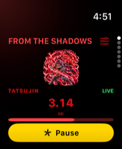](../docs/images/watch/watch-v2-home-ninja.png) [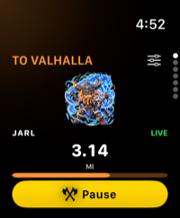](../docs/images/watch/watch-v2-home-viking.png) [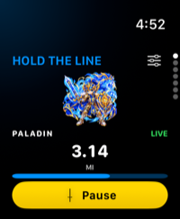](../docs/images/watch/watch-v2-home-knight.png)

**Pirate · Cyborg · Spartan**

[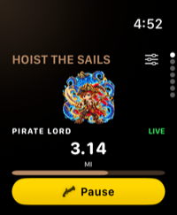](../docs/images/watch/watch-v2-home-pirate.png) [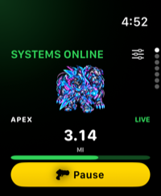](../docs/images/watch/watch-v2-home-cyborg.png) [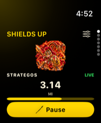](../docs/images/watch/watch-v2-home-spartan.png)

**Ready to train · Paused workout**

[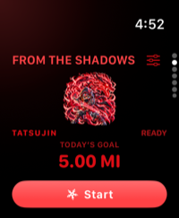](../docs/images/watch/watch-v2-home-ready.png) [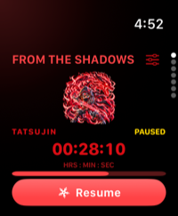](../docs/images/watch/watch-v2-home-paused.png)

**Workout overview · Distance · Heart rate**

[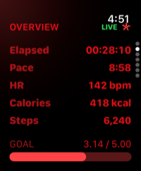](../docs/images/watch/watch-v2-overview.png) [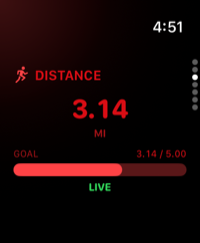](../docs/images/watch/watch-v2-distance.png) [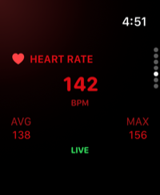](../docs/images/watch/watch-v2-heart-rate.png)

**Workout controls · Dashboard settings · Warrior selection**

[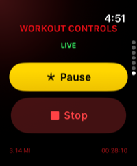](../docs/images/watch/watch-v2-controls.png) [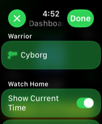](../docs/images/watch/watch-v2-settings.png) [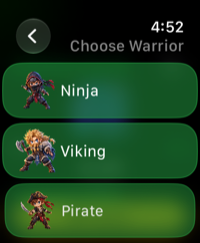](../docs/images/watch/watch-v2-warrior-picker.png)

The gallery uses the shared 3.14-mile workout fixture. Ready uses zero metrics and a 5.00-mile goal; Paused preserves the workout values. Artwork ranks are explicit capture fixtures, not a record of earned achievements. [Capture instructions and provenance](../docs/SCREENSHOTS.md#november-25-watch-v2-gallery).

---

## 10. Connectivity and Recovery

If the iPhone is temporarily unavailable:

- The Watch workout continues
- HealthKit collection continues
- The latest workout state remains authoritative on Watch
- Synchronization can resume when connectivity returns

NinjaPace maintains latest-state checkpoints so the iPhone can reconnect to an already-running workout without replacing newer Watch state with stale data.

---

## 11. Battery and Performance Strategy

The Watch app is intentionally lightweight.

Goals:

- Low CPU overhead
- Minimal unnecessary redraws
- HealthKit-driven updates
- Telemetry pushes at a practical cadence
- Limited decorative animation during workouts
- No unnecessary local networking

The Watch sends telemetry to the iPhone rather than acting as the HTTP streaming server.

---

## 12. Automated UI Testing

The Watch app has deterministic XCUITest launch states.

Launch environment:

```text
NINJAPACE_UI_TEST_STATE
```

Supported states:

```text
ready
live
paused
```

UI coverage includes Home states, Overview metrics, vertical focus-page navigation, persisted page settings, warrior selection, rest days, Pause/Resume, and Stop confirmations. Screenshot attachments cover Ready, Live, Paused, Overview, and Distance on the selected simulator.

Presentation unit tests cover default/custom page lists, unknown or duplicate preference values, formatting, and the presence of all 24 progression artwork assets in the Watch bundle. Existing workout-manager tests remain in place.

DEBUG-only launch options extend the existing state harness:

- `NINJAPACE_UI_TEST_THEME`: a warrior raw key.
- `NINJAPACE_UI_TEST_WARRIOR_LEVEL`: canonical earned level integer (1–4; defaults to 1 in fixtures).
- `NINJAPACE_UI_TEST_SHOW_TIME`: `1` enables the idle screen; `0` disables it.
- `NINJAPACE_UI_TEST_CLOCK_STYLE`: `digital` or `analog`.
- `NINJAPACE_UI_TEST_IDLE_TIMEOUT`: positive timeout in seconds for accelerated interaction tests; production always uses 60 seconds.
- `NINJAPACE_UI_TEST_GOAL`: goal mileage (including zero for rest days).
- `NINJAPACE_UI_TEST_PAGE`: an enabled dashboard page raw key.
- `NINJAPACE_UI_TEST_RESET_DASHBOARD=0`: retain preferences for relaunch tests; otherwise test launches reset all five dashboard preference keys.

These options do not activate HealthKit or WatchConnectivity. Simulator UI fixtures test presentation and action routing; a paired-device workout is still needed to validate hardware Crown interaction, wrist-down behavior, HealthKit collection, and end-to-end telemetry delivery.

---

## 13. Technology

Primary technologies:

- Swift
- SwiftUI
- HealthKit
- WatchConnectivity
- Workout mirroring
- async/await
- XCTest / XCUITest

---

## 14. Role in the NinjaPace Ecosystem

```text
Apple Watch
    │
    │ authoritative workout telemetry
    ▼
iPhone
    │
    │ optional live stream payload
    ▼
Mac Relay
    │
    ▼
OBS
```

The Watch is the workout source of truth.

The iPhone is the training and synchronization hub.

The Mac is the optional streaming bridge.

---

## 15. Potential Future Enhancements

- Heart-rate-zone-aware visual feedback
- Additional workout types
- Interval mode
- More on-Watch training summaries
- More milestone haptics
- Additional accessibility options
- Expanded independent Watch behavior

---

# 🥷 NinjaPace Watch

**Start the workout.  
Own the telemetry.  
Keep moving.**
