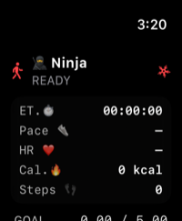
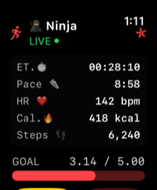
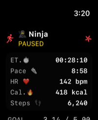

# 🥷 NinjaPace – Apple Watch App

> **The workout authority.**  
> Real-time HealthKit tracking, goal awareness, haptics, and live telemetry for the NinjaPace ecosystem.

[Ecosystem overview](../README.md) · [Streaming HUD](../docs/README-Streaming-HUD.md) · [Screenshot checklist](../docs/SCREENSHOTS.md)

---

## 1. Overview

The NinjaPace Apple Watch app is the primary workout source.

It owns the active `HKWorkoutSession`, collects HealthKit workout data, manages the live workout state, and sends authoritative telemetry to the iPhone.

```text
HealthKit
    ↓
HKWorkoutSession
    ↓
HKLiveWorkoutBuilder
    ↓
WorkoutManager
    ↓
WatchConnectivity / workout mirroring
    ↓
iPhone HealthStreamManager
```

The Watch remains focused on the job that matters most:

> **Keep the workout alive, accurate, and responsive.**

---

## 2. Core Responsibilities

### 🏃 Workout Execution

Supported workout controls:

- Start
- Pause
- Resume
- Stop

The Watch maintains live state for:

- Running
- Paused
- Ready / idle
- Goal progress

### ❤️ HealthKit Telemetry

The Watch can collect and maintain:

- Distance
- Steps
- Heart rate
- Average heart rate
- Peak heart rate
- Active calories
- Total calories
- Elapsed workout time
- Paused time
- Pace
- Speed
- Peak speed

The active workout is based on a HealthKit running session.

### 📡 iPhone Synchronization

The Watch sends live workout snapshots to the iPhone using WatchConnectivity and mirrored-workout support.

The iPhone then becomes the training, persistence, customization, and optional streaming hub.

### 🎯 Goal Synchronization

The Watch receives the current mileage goal from the iPhone and uses it locally for:

- Goal display
- Progress calculation
- Goal-hit detection
- Workout presentation

### 🥷 Theme Synchronization

The selected warrior theme is synchronized from iPhone so the Watch remains visually aligned with the rest of NinjaPace.

---

## 3. WorkoutManager

`WorkoutManager` is the central Watch runtime component.

Responsibilities include:

- Request HealthKit authorization
- Create and manage `HKWorkoutSession`
- Configure `HKLiveWorkoutBuilder`
- Collect HealthKit statistics
- Maintain workout state
- Track pause/resume behavior
- Track elapsed time
- Maintain goal state
- Trigger milestone haptics
- Send live telemetry to iPhone
- Recover state after temporary connectivity changes

Representative state includes:

```swift
isRunning
isPaused

miles
steps
heartRate

activeCalories
totalCalories

elapsedSeconds
goalMiles
```

Additional derived workout metrics can include pace, speed, peak speed, average heart rate, and peak heart rate.

---

## 4. HealthKit Integration

The Watch owns the active workout session.

Typical data flow:

```text
HKWorkoutSession
    ↓
HKLiveWorkoutBuilder
    ↓
HealthKit statistics
    ↓
WorkoutManager
    ↓
Published UI state + telemetry snapshot
```

Common HealthKit quantities include:

```text
distanceWalkingRunning
heartRate
activeEnergyBurned
stepCount
```

Live updates are driven by the workout builder and session state rather than by polling-heavy application timers.

---

## 5. Telemetry to iPhone

A Watch workout snapshot can include values such as:

```swift
[
    "running": true,
    "paused": false,
    "miles": 3.14,
    "hr": 142,
    "steps": 6240,
    "elapsedSeconds": 1690,
    "activeCalories": 418.0,
    "totalCalories": 518.0,
    "goalMiles": 5.0
]
```

The Watch normally pushes fresh telemetry approximately once per second while the workout is active.

The iPhone treats the Watch as the authoritative source for active workout state.

---

## 6. Background Workout Behavior

One of the most important responsibilities of the Watch app is keeping the workout alive when the display is no longer active.

Because NinjaPace owns an active HealthKit workout session:

- Wrist lowering does not end the workout
- Wrist lock does not end the workout
- The display turning off does not end the workout
- HealthKit continues collecting workout data
- Workout state remains recoverable

The workout session, not the visible SwiftUI screen, is the lifetime anchor for the workout.

---

## 7. Pause and Resume

Pause state is explicit and synchronized.

NinjaPace tracks paused time separately so downstream metrics can use active workout time.

```text
Wall-clock duration
    -
Accumulated paused time
    =
Active workout duration
```

This matters for:

- Pace
- Average speed
- Workout summaries
- Historical records

---

## 8. Goal and Milestone Behavior

The Watch receives `goalMiles` from the iPhone.

Goal progress can be derived as:

```swift
progress = goalMiles > 0
    ? min(miles / goalMiles, 1)
    : 0
```

Important behavior:

- `goalMiles == 0` is a valid rest-day value
- Goal-hit behavior should only trigger when the goal is greater than zero
- Mile milestone haptics provide feedback during the workout
- Goal state can drive a dedicated visual state

---

## 9. Watch UI

The Watch UI is intentionally compact and glanceable.

Primary states:

| State | Meaning |
|---|---|
| `READY` | No active workout |
| `LIVE` | Workout is running |
| `PAUSED` | Workout is paused |

Core controls:

- Start / Pause / Resume
- Stop

Core metrics:

- Elapsed time
- Pace
- Heart rate
- Calories
- Steps
- Goal progress

The interface is optimized for quick wrist-level confirmation rather than deep configuration.

[](../docs/images/watch/watch-ready.png) [](../docs/images/watch/watch-live.png) [](../docs/images/watch/watch-paused.png)

---

## 10. Connectivity and Recovery

If the iPhone is temporarily unavailable:

- The Watch workout continues
- HealthKit collection continues
- The latest workout state remains authoritative on Watch
- Synchronization can resume when connectivity returns

NinjaPace maintains latest-state checkpoints so the iPhone can reconnect to an already-running workout without replacing newer Watch state with stale data.

---

## 11. Battery and Performance Strategy

The Watch app is intentionally lightweight.

Goals:

- Low CPU overhead
- Minimal unnecessary redraws
- HealthKit-driven updates
- Telemetry pushes at a practical cadence
- Limited decorative animation during workouts
- No unnecessary local networking

The Watch sends telemetry to the iPhone rather than acting as the HTTP streaming server.

---

## 12. Automated UI Testing

The Watch app has deterministic XCUITest launch states.

Launch environment:

```text
NINJAPACE_UI_TEST_STATE
```

Supported states:

```text
ready
live
paused
```

Current UI coverage includes:

- Ready dashboard
- Live telemetry
- Paused state
- Pause confirmation cancellation
- Pause → Resume flow
- Stop confirmation cancellation
- Stop → Ready flow

Important watchOS test behavior:

- SwiftUI confirmation alerts are tested through their visible action buttons
- Metric accessibility identifiers remain on leaf elements
- Parent accessibility identifiers are avoided when they would hide child identifiers

---

## 13. Technology

Primary technologies:

- Swift
- SwiftUI
- HealthKit
- WatchConnectivity
- Workout mirroring
- async/await
- XCTest / XCUITest

---

## 14. Role in the NinjaPace Ecosystem

```text
Apple Watch
    │
    │ authoritative workout telemetry
    ▼
iPhone
    │
    │ optional live stream payload
    ▼
Mac Relay
    │
    ▼
OBS
```

The Watch is the workout source of truth.

The iPhone is the training and synchronization hub.

The Mac is the optional streaming bridge.

---

## 15. Potential Future Enhancements

- Heart-rate-zone-aware visual feedback
- Additional workout types
- Interval mode
- More on-Watch training summaries
- More milestone haptics
- Additional accessibility options
- Expanded independent Watch behavior

---

# 🥷 NinjaPace Watch

**Start the workout.  
Own the telemetry.  
Keep moving.**
