# 🥷 NinjaPace

**Fitness first. Streaming second.**

NinjaPace brings Apple Watch workout tracking, iPhone training tools, and an optional Mac streaming HUD into one ecosystem. Choose your warrior, set your mileage goal, and follow your progress from your wrist to your stream.

[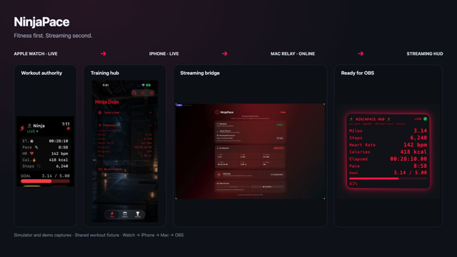](docs/images/hero/ninjapace-ecosystem.png)

*Select any screenshot to open its full-resolution image.*

## What NinjaPace Is

| Component | Role | Guide |
|---|---|---|
| iPhone | Daily goals, training schedule, workout history, awards, and customization | [iPhone app](NinjaPace/README.md) |
| Apple Watch | Owns the HealthKit workout and sends live telemetry | [Watch app](NinjaPaceWatch/README.md) |
| Mac | Optional local telemetry relay and HUD Studio | [Mac companion](NinjaPaceMac/README.md) |
| Streaming HUD | Customizable browser overlay for OBS | [Streaming HUD](docs/README-Streaming-HUD.md) |

```text
Apple Watch → iPhone → Mac relay → OBS / Streaming HUD
             Training   Optional streaming
```

The Watch owns the active workout. The iPhone manages training and synchronization. Fitness features remain useful without the Mac or OBS.

[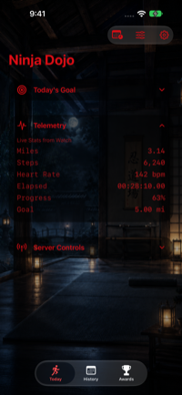](docs/images/iphone/today-live.png) [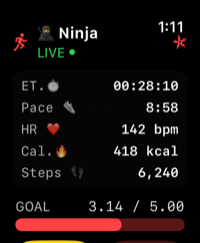](docs/images/watch/watch-live.png) [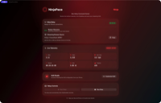](docs/images/mac/mac-relay-live.png)

## Choose Your Warrior

🥷 Ninja · 🪓 Viking · 🛡️ Knight · 🏴‍☠️ Pirate · 🤖 Cyborg · 🏛️ Spartan

Warrior themes shape the app artwork, tint, iconography, and HUD presets. Each identity carries through the training and streaming experience.

[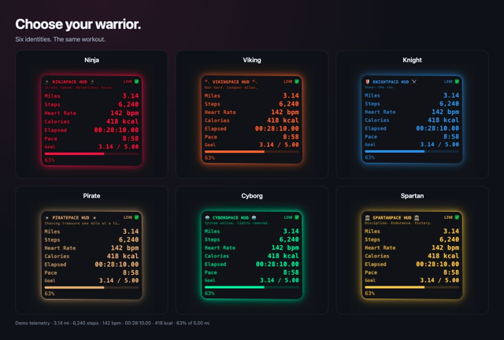](docs/images/hud/hud-six-themes.png)

## Train and Track Your Progress

Set daily mileage goals, plan a week of running and rest, and review completed workouts in History. Workout details can include pace, heart rate, calories, splits, and heart-rate zones. Awards track milestones and progression.

[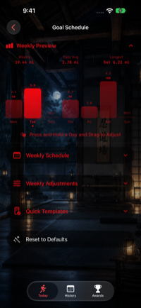](docs/images/iphone/training-schedule.png) [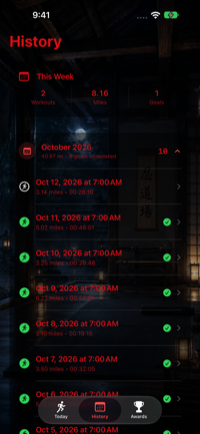](docs/images/iphone/history.png)

## Explore Your Workout Trends

Open **History → Workout Trends** to compare your training by month or year. The History card previews your recent monthly mileage; the full screen lets you choose Miles, Workouts, Duration, Steps, Avg Distance, Avg Pace, Avg Heart Rate, Calories, Cadence, or Goal Rate.

Scroll the chart horizontally to explore earlier periods and select a period to inspect its value and summary. **Training Intel** highlights records and changes from the preceding period, while the best-period card identifies the standout month or year for your selected metric. **Battle Record** summarizes lifetime miles, workouts, and completed goals from your saved history.

Trends use the workout records available in NinjaPace, including recovered workouts. Goal Rate includes only workouts with a known positive mileage target; missing heart-rate, calorie, or cadence data is not treated as a recorded zero. Lower average pace means faster running.

## Awards and Achievement Details

Open **Awards** to explore badges for workout counts, distance milestones, and completed goals. Tap a badge to open its achievement details: unlocked awards show the first-earned date when available, plus qualifying workout counts or current cumulative progress. Locked awards show progress toward their target. When a later milestone remains in the same progression, **Next Target** shows the badge and how much remains.

[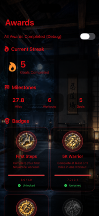](docs/images/iphone/awards.png) [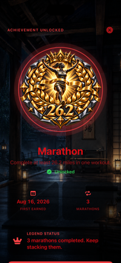](docs/images/iphone/achievement-unlocked.png) [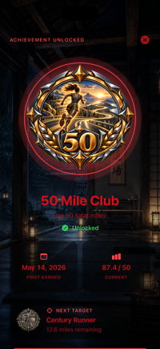](docs/images/iphone/achievement-next-target.png)

*SwiftUI preview captures with sample data. The All Awards Completed switch is Debug-only; achievement details are available in production.*

### NinjaPace Grandmaster

Unlock every lifetime achievement in the current collection to become **NinjaPace Grandmaster**. Awards presents a full-screen **Collection Mastered** celebration with the Grandmaster badge, the completed award count, and **100% COMPLETE**. Select **Enter the Hall of Legends** to return to Awards, where your Grandmaster recognition remains visible. Monthly challenge badges are tracked separately from this lifetime collection.

`AchievementMasteryView` uses the dedicated `.grandmaster` celebration style: three staggered particle bursts and a Grandmaster title, alongside a glowing badge and animated ring. Its dedicated Grandmaster sound plays when Goal Celebrations is enabled.

[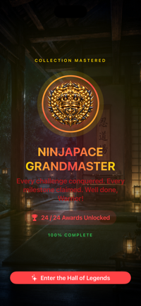](docs/images/iphone/achievement-grandmaster.png)

*SwiftUI preview showing the current 24-award collection. This still captures the mastery screen after the opening particle bursts; it does not demonstrate animation or sound playback.*

### Monthly Challenge Badges

Open **Awards → Monthly Challenges** to explore a collection of 12 monthly missions. Challenges vary between workout counts, total mileage, and a single-workout distance target—for example, November’s **Iron Will** asks you to complete 12 workouts during the month.

Locked badges appear in grayscale with a shield-lock overlay. Earned badges reveal their full-color artwork. Open a month to see its mission, progress, and availability; earned rewards are recorded by month and year in the **Monthly Hall of Legends**.

**Monthly Challenges screen**

[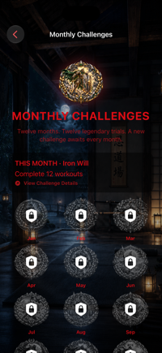](docs/images/iphone/monthly-challenges-screen.png)

*Captured from the Monthly Challenges SwiftUI preview with an empty in-memory workout store. The current mission follows the calendar month.*

**Unlocked monthly challenge**

[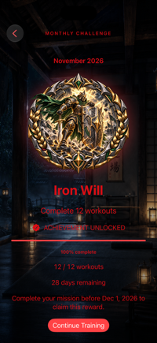](docs/images/iphone/monthly-challenge-unlocked.png)

*The “Monthly Challenge - Unlocked” SwiftUI preview shows November’s Iron Will badge at 100% completion. Its Debug override does not save a reward, so the preview still displays the remaining-time message.*

**Locked collection · Unlocked collection**

[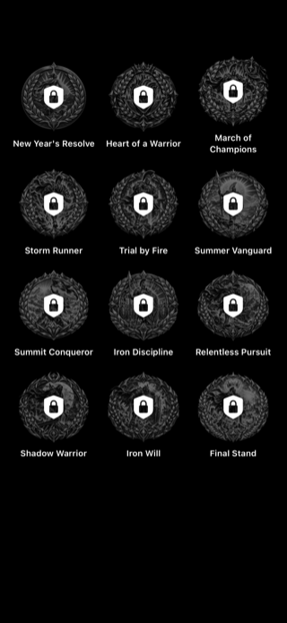](docs/images/iphone/monthly-badges-locked.png) [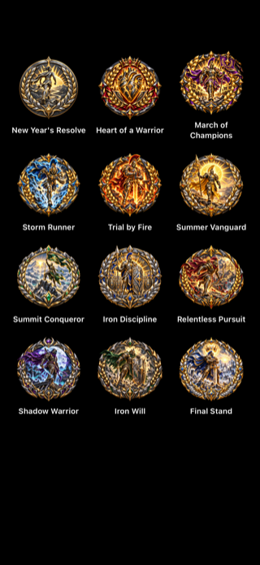](docs/images/iphone/monthly-badges-unlocked.png)

*SwiftUI badge-gallery previews from `MonthlyChallengeBadgeView.swift`, illustrating both visual states. The unlocked collection is a preview, not a record of earned rewards.*

## Stay on Track and Celebrate Your Goals

Open **Settings → Goal Alerts** to enable a daily local reminder and choose its time (6 PM by default). NinjaPace schedules reminders ahead of time, skips rest days, and cancels the day’s pending reminder when it observes your goal completion. Notifications require iOS permission; no remote notification server is needed.

With **Settings → Goal Celebrations** enabled, reaching your target during an active workout while NinjaPace is in the foreground triggers a brief warrior-themed animation, sound, and success feedback. The effect adapts to Reduce Motion. Raising your target above your current progress allows a new celebration when you reach it.

[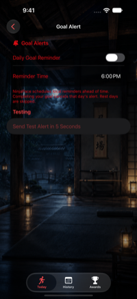](docs/images/iphone/goal-alerts.png) [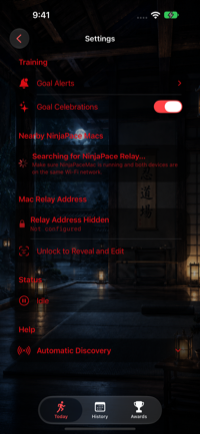](docs/images/iphone/goal-celebration-settings.png) [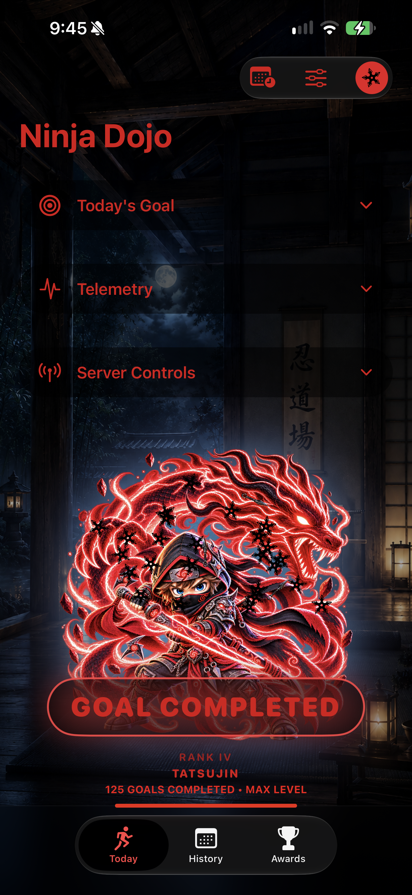](docs/images/iphone/goal-celebration.png)

*Simulator captures. The Testing section is Debug-only; the celebration still uses the Debug preview gesture and includes the simulator window. A still image does not demonstrate sound or notification delivery.*

## Built for iPhone Duo

On the Duo’s compact display, Today’s Goal, Telemetry, and Server Controls become a horizontal row of icons. Tap one to expand its controls; collapse it to return to warrior progress without overlap.

The welcome screen scrolls to keep every warrior and action reachable. Folded layouts use two columns; expanded layouts use three, with square cards that preserve the artwork’s proportions.

**Compact training and folded welcome (scrolled to the actions)**

[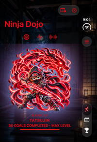](docs/images/iphone/duo-training-compact.png) [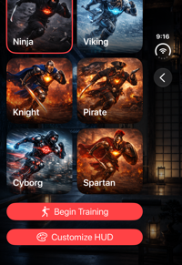](docs/images/iphone/duo-welcome-folded.png)

**Expanded welcome**

[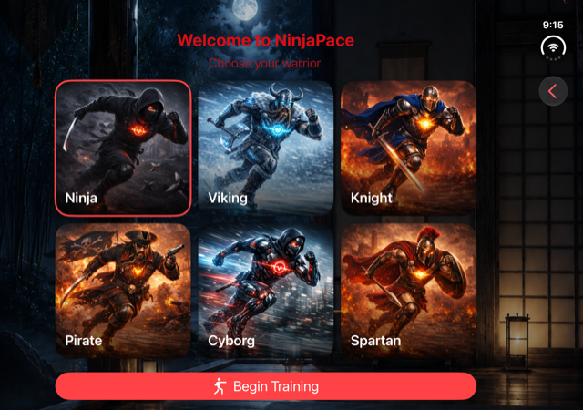](docs/images/iphone/duo-welcome-expanded.png)

*Simulator captures. Training shows demo data with the maximum-rank artwork preview.*

## Recover Your Workout History

If you reinstall NinjaPace and its running workouts are still available in Apple Health, use **History → Recover History** to review and restore them. Health read permission is required; existing workouts are skipped. Recovery and historical goal editing are available in Release builds.

Apple Health does not retain every NinjaPace detail. Restore original mileage targets with **Workout Details → Goal Performance → Set Original Goal** to update completed-goal totals, Awards, and warrior progress. Settings and historical achievement unlocks are not restored automatically. See the [recovery guide](docs/HISTORY-RECOVERY.md).

[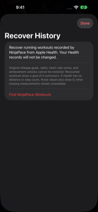](docs/images/iphone/history-recovery.png)

## Bring Your Workout to Your Stream

The Mac companion receives iPhone telemetry over the local network and serves a browser HUD for OBS. The HUD presents Idle, Live, Paused, and Goal Complete states, with distance, steps, heart rate, calories, elapsed time, pace, and goal progress.

No cloud account or remote telemetry backend is required for the streaming path.

[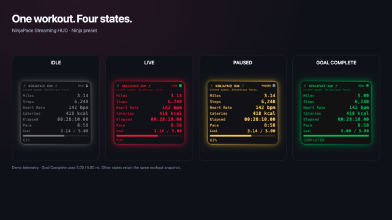](docs/images/hud/hud-states.png)

Customize titles, state colors, backgrounds, borders, text, glow, and metric visibility. HUD Studio can **Follow iPhone** or **Customize on This Mac**.

[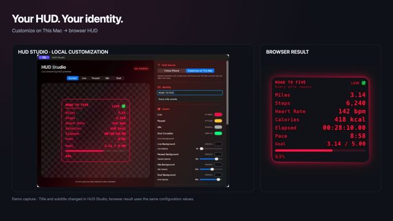](docs/images/hud/hud-customization-before-after.png)

To set up streaming, start the Mac relay, configure the iPhone with the Mac’s LAN address, then add the active relay URL as an OBS Browser Source. See the [OBS setup guide](docs/README-Streaming-HUD.md#4-obs-setup).

[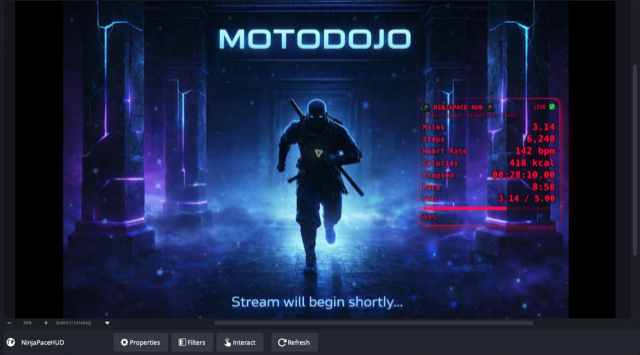](docs/images/hero/ninjapace-in-obs.png)

*Actual OBS preview with demo telemetry over stream artwork. Activity-feed and chat docks are cropped out.*

The Watch continues recording independently during connection gaps. iOS background execution can delay fresh stream telemetry; an advancing HUD timer alone does not confirm fresh metrics. See [background streaming behavior](NinjaPace/README.md#10-background-streaming-behavior).

## Build and Explore

Open `NinjaPace.xcodeproj` in Xcode and choose the iPhone, Watch, or Mac scheme. The app targets currently require iOS 26, watchOS 26, and macOS 26 or later; the iPhone unit-test target currently requires iOS 27. Configure signing for your own paired devices when validating HealthKit and background delivery.

Deterministic UI fixtures support documentation captures and interface checks:

- [iPhone UI tests](NinjaPaceUITests/README.md)
- [Watch UI tests](NinjaPaceWatchUITests/README.md)
- [Mac UI tests](NinjaPaceMacUITests/README.md)

The screenshots use demo telemetry; see the [capture manifest and reproduction notes](docs/SCREENSHOTS.md). Earlier screenshots remain in the [legacy media archive](docs/README-Streaming-HUD.md#24-project-media).
