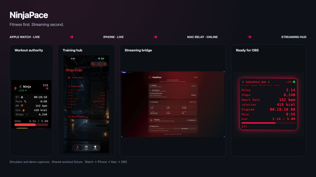
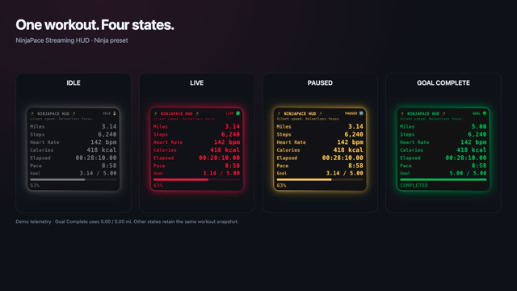
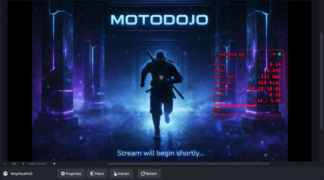
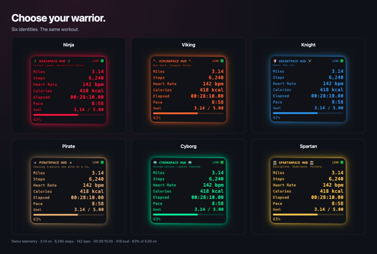
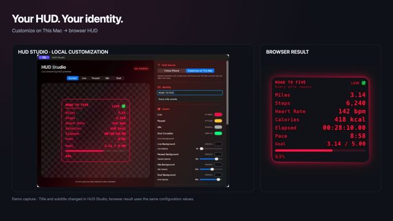
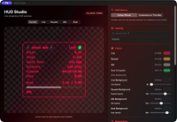
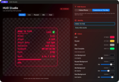

# 🥷 NinjaPace – Streaming HUD

> **The OBS-facing layer of NinjaPace.**  
> A customizable, local browser overlay for real-time workout telemetry.

[Ecosystem overview](../README.md) · [Screenshot capture checklist](SCREENSHOTS.md)

---

## 1. Overview

The NinjaPace Streaming HUD is the browser-based presentation layer of the NinjaPace ecosystem.

It runs inside an **OBS Browser Source** and renders live workout telemetry received by the NinjaPace Mac companion.

```text
Apple Watch
    │
    │ HealthKit workout telemetry
    ▼
iPhone
HealthStreamManager
    │
    │ StatsPushClient
    │ HTTP POST /ingest
    ▼
NinjaPace Mac
MacRelayServer
    │
    ├── GET /stats
    └── GET /
            │
            ▼
      Streaming HUD
            │
            ▼
      OBS Browser Source
            │
            ▼
   Twitch / YouTube / Recording
```

The HUD is intentionally:

- Local-network based
- Low-overhead
- Browser-source friendly
- Theme-aware
- Fully customizable
- Independent of cloud accounts or remote services

The Apple Watch remains the workout authority, the iPhone remains the training and synchronization hub, and the Mac remains the optional streaming bridge.

[](images/hero/ninjapace-ecosystem.png)

---

## 2. What the HUD Displays

The overlay can render:

- Miles
- Steps
- Heart rate
- Active calories
- Elapsed time
- Pace
- Goal progress
- Goal percentage / completion state
- Current workout state
- HUD title
- HUD subtitle

Each metric can be independently shown or hidden through HUD configuration.

---

## 3. HUD States

The browser HUD has four primary presentation states.

| State | Condition |
|---|---|
| **Idle** | No active workout |
| **Live** | Workout running and not paused |
| **Paused** | Workout paused |
| **Goal** | Valid distance goal reached |

Representative state logic:

```text
running == false
    → Idle

running == true && paused == false
    → Live

paused == true
    → Paused

goalMiles > 0 && progress >= 1
    → Goal
```

A mileage goal of `0.00` is valid for a rest day.

The HUD must therefore **not** treat a zero-mile goal as instant completion.

Current browser logic explicitly checks for a positive distance goal before allowing Goal state.

[](images/hud/hud-states.png)

---

## 4. OBS Setup

In OBS:

1. Open **Sources**
2. Choose **Add → Browser**
3. Name the source something like `NinjaPace HUD`
4. Enter the active URL shown by NinjaPace Mac
5. Choose a Browser Source canvas large enough for the HUD
6. Leave Custom CSS blank unless you intentionally want to override NinjaPace styling

Typical URL:

```text
http://<MAC_LAN_IP>:8787/
```

If the Mac relay falls back to another port, use the active URL shown in NinjaPace Mac instead of assuming `8787`.

### Browser Source sizing

The HUD is scalable.

If text looks soft in OBS:

- Increase the Browser Source width and height
- Keep the HUD rendered at a higher browser resolution
- Scale the source down inside the OBS scene

This usually produces cleaner text than rendering the source at a very small native browser resolution.

[](images/hero/ninjapace-in-obs.png)

*Actual OBS preview with demo telemetry over stream artwork. Activity-feed and chat docks are cropped out.*

---

## 5. Relay Port Behavior

The preferred NinjaPace relay port is:

```text
8787
```

If that port is unavailable, the Mac companion searches a fallback range:

```text
8787 ... 8795
```

The Mac app exposes the actual active relay URL.

Use that URL for:

- OBS Browser Source
- iPhone relay configuration
- Manual browser testing
- Local `/stats` inspection

---

## 6. HTTP Endpoints

The Streaming HUD uses the NinjaPace Mac relay.

Primary endpoints:

```text
POST /ingest
GET  /stats
GET  /
```

### `POST /ingest`

Used by the iPhone app.

Receives the latest workout telemetry and optional HUD configuration.

### `GET /stats`

Used by the browser HUD.

Returns the most recent telemetry snapshot as JSON.

### `GET /`

Serves the NinjaPace browser HUD itself.

OBS normally points directly to this route.

---

## 7. Telemetry Contract

Representative telemetry:

```json
{
  "theme": "ninja",
  "running": true,
  "paused": false,
  "miles": 3.14,
  "steps": 6240,
  "hr": 142,
  "elapsed": "00:28:10.00",
  "elapsedSeconds": 1690,
  "elapsedMilliseconds": 1690000,
  "pace": "8:58",
  "activeCalories": 418.0,
  "totalCalories": 518.0,
  "goalMiles": 5.0,
  "progress": 0.63,
  "hudConfiguration": {
    "...": "..."
  }
}
```

Representative Swift model:

```swift
struct Stats: Codable, Sendable {
    var theme: String?

    var miles: Double
    var steps: Int
    var hr: Int

    var elapsed: String
    var elapsedSeconds: Int
    var elapsedMilliseconds: Int

    var pace: String

    var activeCalories: Double
    var totalCalories: Double

    var goalMiles: Double
    var progress: Double

    var running: Bool
    var paused: Bool

    var hudConfiguration: HUDConfiguration?
}
```

The Mac also tracks when the latest telemetry payload was received.

That timestamp is used for smooth elapsed-time interpolation.

---

## 8. Browser Polling

The current HUD polls:

```text
GET /stats
```

every:

```text
500 ms
```

The fetch disables browser caching so each request sees current relay state.

Conceptually:

```javascript
async function tick() {
  const response = await fetch("/stats", {
    cache: "no-store"
  });

  const data = await response.json();
  updateHUD(data);
}

tick();
setInterval(tick, 500);
```

The HUD does **not** need telemetry POSTs at browser-frame rate.

---

## 9. Smooth Elapsed Time

Elapsed time is intentionally smoother than the network update cadence.

The Watch provides authoritative workout time checkpoints.

The iPhone interpolates between Watch updates.

The Mac keeps the most recent authoritative elapsed checkpoint and timestamp.

The browser HUD then renders elapsed time continuously using `requestAnimationFrame`.

Conceptually:

```text
Latest authoritative elapsed checkpoint
    +
Local time since checkpoint
    =
Current displayed elapsed time
```

Interpolation advances only while:

```text
running == true
paused == false
```

When the workout is paused or idle, elapsed time remains fixed at the latest authoritative value.

This keeps the stopwatch visually smooth without increasing network traffic.

---

## 10. Warrior Themes

NinjaPace supports six complete warrior identities:

- 🥷 Ninja
- 🪓 Viking
- 🛡️ Knight
- 🏴‍☠️ Pirate
- 🤖 Cyborg
- 🏛️ Spartan

Each warrior can provide its own:

- HUD title
- Subtitle
- Live color
- Paused color
- Idle color
- Goal color
- Background treatment
- Glow intensity
- Text treatment
- Overall streaming presentation

The selected warrior can follow the iPhone into the Mac relay and browser HUD.

Examples include titles such as:

```text
🥷 NINJAPACE HUD 🥷
🪓 VIKINGPACE HUD 🪓
🛡️ KNIGHTPACE HUD ⚔️
🏴‍☠️ PIRATEPACE HUD 🏴‍☠️
🤖 CYBORGPACE HUD 🤖
🏛️ SPARTANPACE HUD 🏛️
```

[](images/hud/hud-six-themes.png)

---

## 11. HUD Configuration

The HUD is no longer a fixed red/yellow/green overlay.

`HUDConfiguration` can control the identity, visual treatment, and visible metrics of the browser overlay.

Current customization areas include:

### Identity

- HUD title
- Subtitle
- Theme key

### State colors

- Live
- Paused
- Idle
- Goal complete

### State backgrounds

Each state can have its own:

- Background color
- Background opacity

Supported states:

- Live
- Paused
- Idle
- Goal

### Appearance

- HUD scale
- Glow intensity
- Text scale
- Text weight
- Text outline
- Border enabled
- Border width

### Visible metrics

- Miles
- Steps
- Heart Rate
- Calories
- Elapsed
- Pace
- Goal

[](images/hud/hud-customization-before-after.png)

---

## 12. Follow iPhone vs Customize on This Mac

The Mac HUD Studio supports two configuration modes:

```text
Follow iPhone
Customize on This Mac
```

### Follow iPhone

The Mac uses HUD settings received from NinjaPace on the iPhone.

This is useful when the iPhone is the primary place where the user manages:

- Warrior theme
- HUD identity
- Colors
- Visibility
- Appearance

### Customize on This Mac

Workout telemetry still comes from the iPhone, but the Mac controls how the OBS HUD looks.

Local Mac customization can include:

- HUD title
- Subtitle
- Colors
- State backgrounds
- Text treatment
- Glow
- Border
- Scale
- Metric visibility

Mac-local overrides are persisted independently from iPhone-following mode.

[](images/mac/mac-hud-studio-follow-iphone.png) [](images/mac/mac-hud-studio-local.png)

---

## 13. Visible Metrics

The HUD can show or hide individual metric blocks.

Current supported toggles:

```text
Miles
Steps
Heart Rate
Calories
Elapsed
Pace
Goal
```

This makes it possible to build:

- Full telemetry HUDs
- Minimal marathon overlays
- Heart-rate-focused layouts
- Distance-only layouts
- Cleaner game-stream overlays

---

## 14. Goal Progress

The HUD displays both numeric and visual goal progress.

Typical presentation:

```text
3.14 / 5.00
63%
```

The progress bar width follows the normalized progress value.

When a valid goal is reached:

```text
COMPLETED
```

replaces the percentage label and the HUD enters Goal state.

Goal completion requires:

```text
goalMiles > 0
```

so a legitimate `0.00 mi` rest-day goal remains an idle/rest state instead of immediately triggering celebration behavior.

---

## 15. Heart-Rate-Driven Pulse

When the goal has not been completed, the browser HUD can derive part of its pulse/glow intensity from current heart rate.

The HUD updates a CSS pulse variable from telemetry.

This allows the presentation to feel alive without requiring heavy animation or high-frequency network updates.

---

## 16. Failure Behavior

If `/stats` cannot be loaded:

- The browser logs a HUD-disconnected error
- The page remains loaded
- The last rendered HUD state is not intentionally destroyed
- The next polling interval tries again

Temporary telemetry gaps therefore do not require reloading the OBS Browser Source.

---

## 17. Local Network Model

The NinjaPace streaming path is designed for trusted local-network use.

Normal deployment:

```text
Watch → iPhone → Mac → OBS
```

Characteristics:

- Local HTTP
- No cloud account required
- No remote telemetry backend
- No streaming database
- Latest live state held in memory
- Browser HUD served by the Mac

The iPhone must target the Mac's LAN address.

Do **not** configure the iPhone relay with:

```text
localhost
```

because `localhost` on iPhone refers to the iPhone itself.

---

## 18. iPhone Background Limitation

The Apple Watch can continue recording the workout while its UI is backgrounded because the active HealthKit workout session owns the workout lifecycle.

The iPhone may eventually be suspended by iOS while backgrounded.

If this occurs:

- The Watch workout continues
- Workout data remains safe
- The Mac retains the latest telemetry snapshot
- The Mac/browser can continue elapsed-time interpolation from the latest checkpoint
- Fresh distance, heart rate, steps, calories, and other telemetry may pause
- Fresh telemetry resumes when iOS wakes NinjaPace or the user foregrounds it

For continuous stream telemetry, keep NinjaPace active on the iPhone during the stream.

This limitation affects the live streaming bridge, not workout integrity.

---

## 19. Performance Strategy

The Streaming HUD is intentionally lightweight.

Current approach:

- HTTP polling every 500 ms
- Browser rendering independent from network cadence
- `requestAnimationFrame` for elapsed-time display
- DOM text updates for metrics
- CSS-driven presentation
- In-memory relay state
- No database access in the HUD path
- No cloud round trip

The goal is responsive presentation without turning telemetry into a high-frequency network firehose.

---

## 20. Troubleshooting

### HUD does not load

Check:

- NinjaPace Mac is running
- Relay is online
- OBS URL matches the **active** Mac relay URL
- Mac and streaming computer are on the expected local network
- The relay port is not blocked by local firewall rules

### `8787` does not work

The relay may have fallen back to another port.

Check the active URL shown in NinjaPace Mac.

Current fallback range:

```text
8787 ... 8795
```

### HUD loads but telemetry does not change

Check:

- iPhone NinjaPace is active
- iPhone relay address points to the Mac's LAN IP
- Relay status is connected / receiving
- Watch telemetry is reaching the iPhone
- iPhone has not been suspended in the background

### Elapsed time moves but metrics appear stale

That can happen when the Mac/browser is interpolating elapsed time from the last checkpoint while fresh iPhone telemetry is temporarily unavailable.

### Goal instantly shows complete on a rest day

That behavior is not expected in the current HUD.

Goal state requires a positive `goalMiles`.

A rest-day value of:

```text
0.00
```

must not trigger Goal state.

### HUD looks blurry in OBS

Increase the Browser Source render size, then scale the source down inside the OBS scene.

---

## 21. Browser HUD Implementation

The HUD is implemented with:

- HTML
- CSS
- JavaScript
- Local HTTP fetch
- DOM updates
- CSS custom properties
- `requestAnimationFrame`
- JSON telemetry

No heavyweight web framework is required for the current overlay.

The browser source receives its presentation data dynamically from `hudConfiguration`.

---

## 22. Relationship to the Other NinjaPace Apps

### Apple Watch

Owns the workout and authoritative HealthKit telemetry.

### iPhone

Receives Watch telemetry and manages:

- Daily goals
- Training schedule
- History
- Achievements
- Warrior theme
- HUD configuration
- Mac relay transmission

### Mac

Receives iPhone telemetry and:

- Hosts the local relay
- Stores the latest snapshot
- Interpolates elapsed time
- Hosts the browser HUD
- Supports local HUD overrides

### Streaming HUD

Turns the relay state into the on-stream visual presentation.

---

## 23. Automated Testing Around the HUD

The browser layer is also protected indirectly by deterministic UI-test coverage around the apps that configure and host it.

Current automated coverage includes:

### iPhone

- HUD editor navigation
- Preview collapse / expansion
- Live / Idle / Goal preview states
- Metric visibility persistence
- Reset-to-theme-preset behavior
- HUD title persistence
- Warrior selection → HUD preset integration

### Mac

- Relay offline / waiting / live states
- Deterministic live telemetry
- Relay stop behavior
- HUD Studio window launch
- Launch performance

This keeps the configuration and relay surfaces stable even though the final browser rendering remains a separate HTML/CSS/JavaScript layer.

---

## 24. Project Media

Current captures appear alongside their relevant sections above. See the [capture manifest](SCREENSHOTS.md) for fixture values, sources, and reproduction notes.

<details>
<summary>Legacy NinjaPace screenshots and early prototypes</summary>

These images and videos show earlier versions of NinjaPace.

### Legacy Browser HUD


Legacy video:

https://github.com/user-attachments/assets/f86067ff-8f94-43e5-87e1-3e3e16b81827

Legacy video:

https://github.com/user-attachments/assets/4185903e-729e-4bfc-99e5-66a0d034b9a2

### Legacy Watch App


### Legacy Mac App


</details>

---

## 25. Potential Future Enhancements

Potential directions include:

- Additional HUD layout presets
- More saved HUD profiles
- Additional stream integrations
- WebSocket-based delivery
- Expanded accessibility options
- More warrior themes
- More visual goal-completion effects
- Multi-output layouts
- Additional browser rendering tests
