# Store screenshot workbench

**Candidates only — not an approved upload set.** iPhone set recaptured in **Dark Mode on November 6, 2026**; Watch/Mac candidates remain from November 5. Original ecosystem README images remain unchanged.

## Dark-mode iPhone gallery

Select a thumbnail to open the full-resolution, opaque JPEG export. PNG originals are retained alongside them. These replace the previous light-appearance iPhone candidates; final release review is still required.

[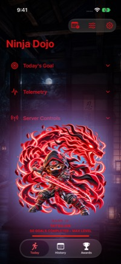](iphone-training-max-level-candidate.jpg) [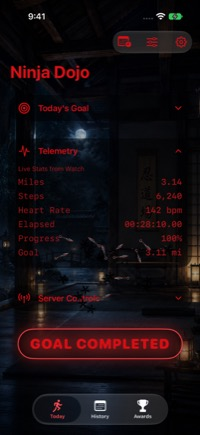](iphone-goal-celebration-candidate.jpg) [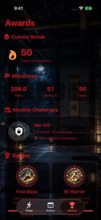](iphone-awards-candidate.jpg) [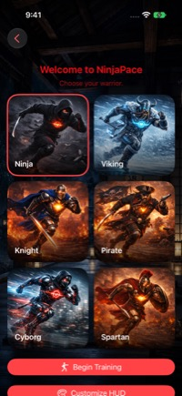](iphone-warrior-selection-candidate.jpg) [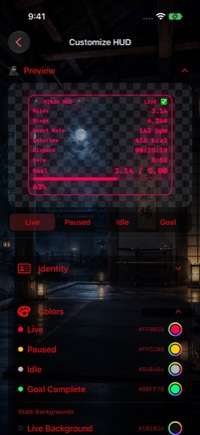](iphone-hud-customization-candidate.jpg) [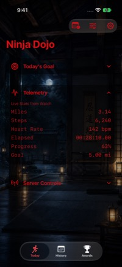](iphone-live-candidate.jpg) [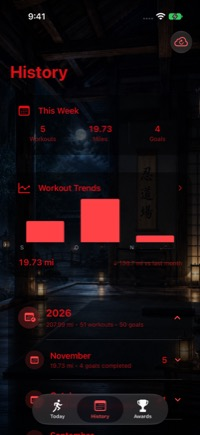](iphone-history-candidate.jpg) [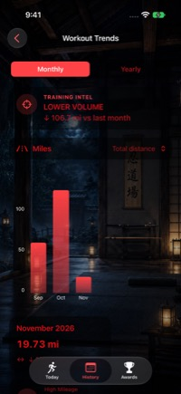](iphone-trends-candidate.jpg)

[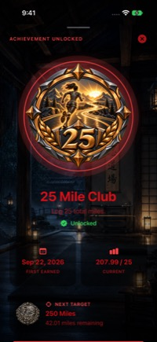](iphone-25-mile-club-candidate.jpg)

[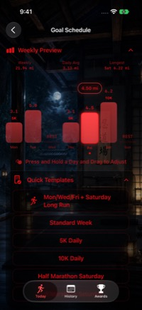](iphone-goal-schedule-candidate.jpg)

[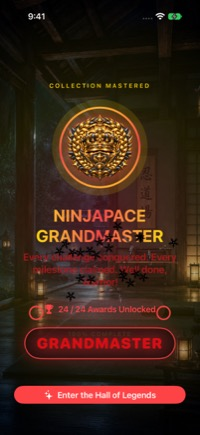](iphone-goal-mastery-view-candidate.jpg)

## iPhone Duo — Viking theme

Expanded landscape Duo captures in Dark Mode, at native **2853 × 2007** resolution. The expanded layout keeps the complete monthly chart and its labels visible. History has its year section collapsed for a clean overview.

[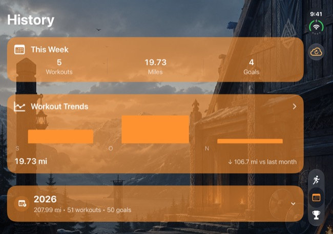](iphone-duo-viking-history-candidate.jpg)

[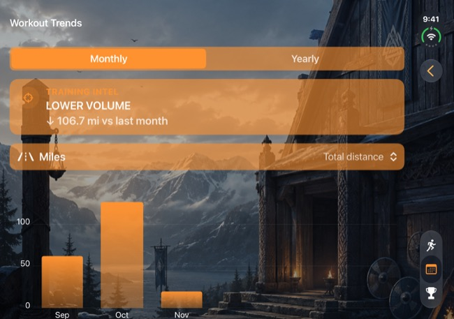](iphone-duo-viking-trends-candidate.jpg)

## Fresh captures

| File | Source | Review status |
|---|---|---|
| [Duo Viking history](iphone-duo-viking-history-candidate.jpg) | WorkoutHistoryView, expanded iPhone Duo, iOS 27.2 | Dark mode; Viking; weekly summary and collapsed 2026 totals; 51 synthetic workouts, 50 goals |
| [Duo Viking trends](iphone-duo-viking-trends-candidate.jpg) | WorkoutTrendsView, same Duo and fixture | Dark mode; Viking; monthly miles with September–November labels visible |
| [Achievement Mastery](iphone-goal-mastery-view-candidate.jpg) | AchievementMasteryView | Dark mode; 24/24 demo collection; GRANDMASTER celebration banner held visible |
| [Goal Schedule](iphone-goal-schedule-candidate.jpg) | TrainingScheduleSettingsView | Dark mode; Quick Templates expanded directly below chart; Friday 4.50 mi callout |
| [Training — max level](iphone-training-max-level-candidate.jpg) | TrainingHomeView, 50 completed goals | Dark mode; Rank IV Tatsujin; all sections collapsed |
| [Goal celebration](iphone-goal-celebration-candidate.jpg) | GoalCelebrationView over live telemetry | Dark mode; 3.14 / 3.11 mi, 100%; real animation renderer held at 0.85 seconds |
| [25 Mile Club — expanded](iphone-25-mile-club-candidate.jpg) | Awards → 25 Mile Club → expand sheet | Dark mode; unlocked AchievementDetailView; full badge, first-earned date, current miles and next target |
| [Awards](iphone-awards-candidate.jpg) | AwardsView, same 51-workout sample history | Dark mode; 50 goals; some badges earned, others locked; no Debug toggle |
| [Warrior Selection](iphone-warrior-selection-candidate.jpg) | WarriorSelectionView | Dark mode; all six warriors visible, Ninja selected |
| [HUD Customization](iphone-hud-customization-candidate.jpg) | HUDCustomizationView | Dark mode; LIVE preview and Colors expanded |
| [iPhone telemetry](iphone-live-candidate.jpg) | Dedicated iPhone 17, iOS 27.2, synthetic LIVE fixture | Dark mode; telemetry expanded; 3.14 / 5.00 mi |
| [iPhone history](iphone-history-candidate.jpg) | Same device, 51 in-memory synthetic workouts | Dark mode; 207.99 miles, 50 completed goals |
| [iPhone trends](iphone-trends-candidate.jpg) | Same fixture, History → Workout Trends | Dark mode; three months of sample workouts |
| [Watch metrics](watch-live-candidate.png) | Dedicated Ultra 4 simulator, watchOS 27.2, synthetic LIVE fixture | 422 × 514; goal row is clipped at bottom — reframe before upload |
| [Watch goal and controls](watch-goal-controls-candidate.png) | Same Watch, scrolled to goal/controls | 422 × 514; complementary lower viewport; upper metrics scrolled out |
| [Mac relay](mac-relay-waiting-candidate.jpg) | Running local Mac app, waiting for telemetry | 1569 × 1050; reference only, wrong aspect ratio for store upload; installed build revision unverified |

The eleven iPhone 17 candidates are 1206 × 2622; the two expanded Duo candidates are 2853 × 2007. Phone/Watch captures use Debug builds and opt-in fixture flags; iPhone images were refreshed against the November 6 source. No physical-device app installed or deleted. Phone workout storage is in-memory; simulator preferences remain on simulators; the Duo capture uses the existing iPhone Duo simulator. The Mac capture contains no workout records and only a loopback URL; it does not show a live workout.

PNG files are raw simulator exports with alpha channels. Companion `.jpg` exports remove alpha for format evaluation; they remain candidates, not approved assets. No UI was painted over or stretched.

## Capture targets

Apple lists 1206 × 2622 as an accepted required iPhone size. Use 422 × 514 consistently for this Watch set. Mac needs 16:10 at an accepted size such as 1440 × 900 or 2880 × 1800. If iPad support remains enabled, capture its required 13-inch set, such as 2064 × 2752. Upload PNG/JPEG with no transparency, 1–10 images per device size. Recheck requirements at submission. [Apple screenshot specifications](https://developer.apple.com/help/app-store-connect/reference/app-information/screenshot-specifications/).

## Final shot list

| Platform | Recommended order |
|---|---|
| iPhone | Warrior/training goal; live workout telemetry; schedule and local alerts; history/recovery; workout trends; awards and an earned monthly challenge; optional streaming setup |
| Watch | Ready/goal; live metrics with complete goal; pause/resume controls |
| Mac | Live relay command center; HUD Studio customization; actual browser HUD output with clear companion context |
| iPad, if retained | Training, History/trends, Awards at the supported native layout |
| Duo | Folded training; expanded warrior picker; validate current requirements at upload |

Capture the actual release-candidate UI with synthetic, internally consistent data. Exclude Debug switches, preview canvas chrome, simulated achievement overrides that contradict reward state, private health data, and LAN addresses. Treat browser/OBS composites as supplementary material, not substitutes for native app screenshots. Keep README thumbnails out of the upload set.

## Reproduction notes

- Derived data: `/tmp/ninjapace-store-capture`; scheme NinjaPace, Debug, generic iOS Simulator. Includes Watch build.
- iPhone simulator: `30DFFC87-6F9A-45ED-B48C-C6B2BBCC92A4` (NinjaPace Store Capture).
- Duo simulator: `341A525A-5DD6-4EFB-BEA6-CBCDA1DBB686`, expanded landscape; capture with `--display=3`. Add `NINJAPACE_SCREENSHOT_THEME=viking` to the phone fixture flags. This optional theme override runs only inside the Debug screenshot harness; normal launches retain their selected theme. Navigate History → Workout Trends normally.
- Watch simulator: `BF940B4E-CF7D-49F5-A6A4-2FF9B5D39A67` (NinjaPace Store Watch).
- Phone flags: `NINJAPACE_IPHONE_UI_TEST_STATE=live`, `NINJAPACE_SCREENSHOT_DATA=1`, `NINJAPACE_SCREENSHOT_PROFILE=max-level`. The profile seeds 51 workouts, 50 completed goals, into the in-memory container. Omitting the profile preserves the original ten-record fixture.
- Optional `NINJAPACE_SCREENSHOT_SCREEN=warriors|hud|celebration` opens the corresponding real view within the Debug harness. Omit it for Training, then navigate to History/Trends/Awards normally. Celebration sets the active goal to 3.11 miles and holds its renderer at 0.85 seconds; it is a still illustration, not evidence of animation/audio playback.
- Dark appearance: `xcrun simctl ui <device> appearance dark`. Verified with `xcrun simctl ui <device> appearance`.
- Debug simulator and unsigned Release builds passed after fixture changes. No production launch paths seed screenshot data or freeze celebrations.
- Watch flag: `NINJAPACE_UI_TEST_STATE=live`.
- Simulator screenshots captured using `xcrun simctl io <device> screenshot <path>`; navigation through Device Hub. Phone status bar set to 9:41 on this dedicated simulator.
- Mac window captured through native UI screenshot API; restored its original window height afterward.

See [inventory.csv](inventory.csv) for dimensions and channel checks. Pixel compliance alone is not visual approval or evidence of production behavior.

### Expanded 25 Mile Club capture

Opened the earned `achievementBadge_twentyFiveMiles` from Awards, then activated the sheet grabber to its **Expanded** state before capture. This is `AchievementDetailView`, not `MonthlyChallengeBadgeView`: 25 Mile Club is a lifetime mileage award. The same synthetic history supplies 207.99 miles and the first-earned date; the next unearned milestone is 250 Miles. No source changes were needed for this capture.

### Goal Schedule capture

Captured November 6 on the dedicated iPhone simulator. Open Today → Goal Schedule, then expand Quick Templates. `NINJAPACE_SCREENSHOT_SCREEN=schedule` (with the existing UI-test and screenshot-data flags) seeds Friday at 4.50 miles, holds the real drag callout on Friday, and scrolls the expanded templates to the top of the form. This is a Debug-only capture behavior; ordinary launches and Release retain normal gestures and scrolling. Weekly total is 21.94 miles, daily average 3.13, longest Saturday 6.22. No template was applied during capture. Debug simulator and unsigned Release builds passed.

### Achievement Mastery capture

`NINJAPACE_SCREENSHOT_SCREEN=mastery`, together with the UI-test and screenshot-data flags, presents the real AchievementMasteryView using `Achievement.allCases.count` (24 at capture). This is a standalone completed-collection demonstration, not an assertion that the separate sample workout history unlocks every award. The real grandmaster celebration renderer is held at 0.85 seconds in Debug so its GRANDMASTER banner remains visible. No artwork or text was painted into the screenshot. The capture retains the actual overlay placement, including its overlap with the completion caption. Debug simulator and unsigned Release builds passed.
